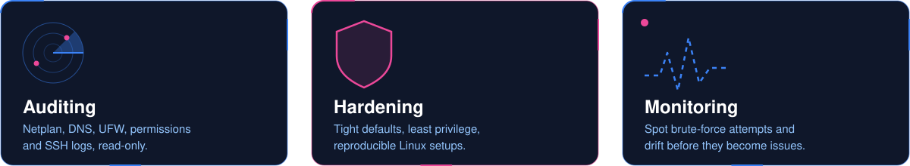

  
   
  
   
  
  
  <h2>About me</h2>
  
  
  
  
Building web apps with Next.js, TypeScript and Flask

  
Linux tinkerer, always customizing something

  
Learning by shipping small projects

  
  
  
  <h2>Featured project</h2>
  
  <!-- CORREGIDO: alt="" vacío para eliminar el texto azul flotante -->
  

  
   
  
  
   
  

